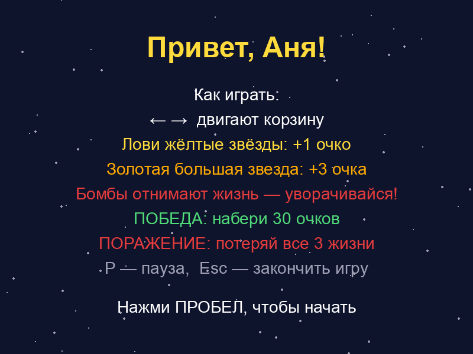
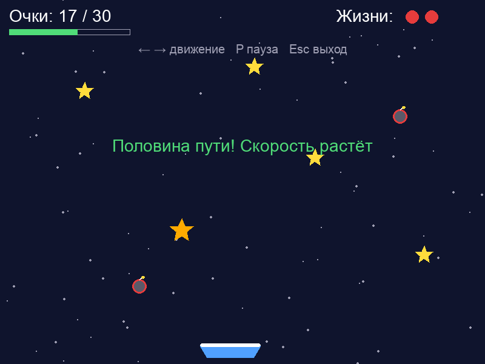
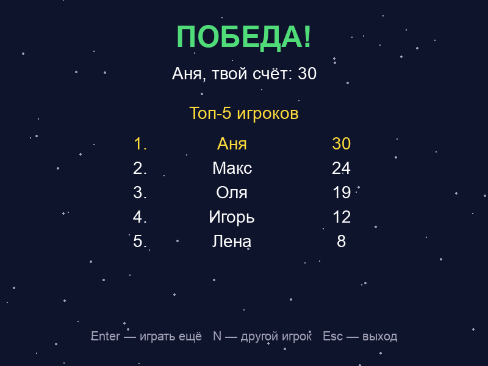

# Звёздный ловец

Аркадная игра на PyGame: двигайте корзину стрелками, ловите звёзды и уворачивайтесь от бомб.

## Скриншоты

| Ввод имени | Правила |
|---|---|
|  |  |

| Игра | Победа и топ-5 |
|---|---|
|  |  |

## Как запустить

```bash
pip install -r requirements.txt
python main.py
```

## Правила

1. Перед началом игры введите своё имя и нажмите **Enter**.
2. Прочитайте правила и нажмите **Пробел**.
3. **← →** двигают корзину.
4. Жёлтая звезда даёт **+1** очко, большая золотая **+3**.
5. Бомба отнимает одну жизнь.
6. **Победа:** набрать 30 очков. **Поражение:** потерять все 3 жизни.
7. **P** ставит паузу, **Esc** досрочно завершает игру.

Чем больше очков, тем быстрее падают предметы. После игры показывается топ-5 игроков, а результаты хранятся в базе SQLite `records.db`.

## Структура проекта

| Файл | Что внутри |
|---|---|
| `main.py` | Точка входа: создаёт объект `Game` и запускает его |
| `game.py` | Класс `Game`: экраны, игровой цикл, очки, победа и поражение |
| `sprites.py` | Классы `Player` (главный персонаж), `FallingObject`, `Star`, `GoldStar`, `Bomb` |
| `database.py` | Класс `Database`: работа с SQLite (сохранение результата и топ-5) |
| `logger.py` | Класс `DbLogger`: журнал всех обращений к базе в файле `db_log.txt` |
| `settings.py` | Константы: размеры окна, цвета, правила |
| `docs/make_screenshots.py` | Скрипт, который делает скриншоты для этого README |

## Соответствие требованиям

| Требование | Где реализовано |
|---|---|
| Управление стрелками | `Player.update()` в `sprites.py` |
| Запрос имени перед игрой | Экран `NAME_INPUT`, метод `Game.handle_name_input()` |
| Подсчёт очков | `Game.update()`, атрибут `score` и полоса прогресса на экране |
| Можно выиграть и проиграть | `Game.update()`: 30 очков дают победу, 0 жизней дают поражение |
| Топ-5 после игры | `Game.finish()` и `Game.draw_game_over()` |
| SQLite3 | Класс `Database` в `database.py` |
| ООП | Классы `Player`, `FallingObject` и его наследники, `Database`, `DbLogger`, `Game` |
| Логи взаимодействия с БД | Класс `DbLogger`: каждое действие с базой пишется в `db_log.txt` и в консоль |
| Подсказки по ходу игры | Экран правил, подсказки управления на экране, всплывающие сообщения |
